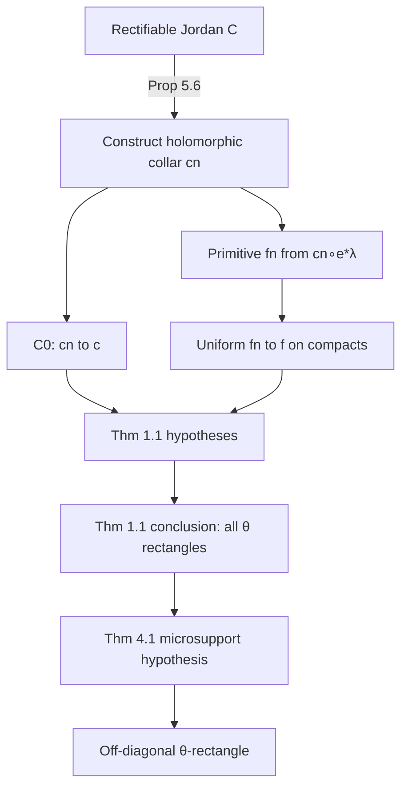

# Asano–Ike Dependency Graph (AI-PEG-v3)

**Source:** arXiv:2412.21057v3 (2026-01-05), SHA-256 `84395599…5101`

---

## Chain (rectifiable → rectangle)

---

## Theorem 1.1 (AI-PEG-v3, §1)

**Hypotheses:**

1. \(c:S^1\to\mathbb{R}^2\) Jordan; \(\mathrm{meas}(c(S^1))=0\); enclosed area \(=\pi\).
2. Smooth Jordan \(c_n\) with \(c_n\to c\) in \(C^0\).
3. \(f_n\) = primitive of \((c_n\circ e)^*\lambda\); \(f_n\to f\) uniformly on compact sets of \(\mathbb{R}\).

**Conclusion:** \(c\) inscribes a \(\theta\)-rectangle for every \(\theta\in(0,\pi)\).

**Arrow type:** SOURCE_THEOREM

---

## Theorem 4.1 (§4)

**Setup:** \(C=\phi(C_0)\), \(F_C=\mathcal{K}(\phi\times\phi)F_{C_0}\).

**Hypothesis:** \(T_a\mathrm{SS}(F_C)\cap\mathrm{SS}(F_C)=\emptyset\) for all \(a\in\mathbb{R}\setminus\pi\mathbb{Z}\).

**Conclusion:** \(C\) inscribes \(\theta\)-rectangle for any \(\theta\in(0,\pi)\).

**Arrow type:** SOURCE_THEOREM

---

## Lemma 4.2 (§4) — diagonal cohomology

For \(\theta\in(0,\pi)\), the \(H^1(S^1)\)-action on the section of \(\mu hom(F_{C_0},R_\theta^\phi F_{C_0})\) corresponding to \(\tau_{0,0}^{0,\theta}\) is **zero**.

**Use:** Excludes diagonal contribution in microlocal Hom; supports off-diagonal rectangle (Remark 4.2 context).

**Arrow type:** SOURCE_THEOREM

---

## Proposition 5.1 (§5)

Sheaf quantization \(F_C\) exists for any Jordan curve \(C\) (limit/interleaving construction).

**Arrow type:** SOURCE_THEOREM

---

## Proposition 5.6 + Corollary 5.7 (§5)

Rectifiable \(C\) with area \(\pi\) satisfies Theorem 1.1 hypotheses → inscribes all \(\theta\)-rectangles.

**Arrow type:** SOURCE_THEOREM

---

## Proposition 5.9 + Corollary 5.10 (§5)

Locally monotone \(C\) satisfies Theorem 1.1.

**Arrow type:** SOURCE_THEOREM

---

## Remarks 5.5, 5.4, 5.7 (§5)

| Case | Status |
|------|--------|
| Positive-measure curves | Thm 1.1 via Hamiltonian homeomorphism |
| Measure-zero curves | Need approximation + primitive convergence |
| Residual | Cohomological vanishing / primitive uniqueness (Remark 5.5) |

---

## Proof of Theorem 1.1 (§5)

Uses measure-zero → compactly supported Hamiltonian \(\phi\) with \(C=\phi(C_0)\); then Theorem 4.1.

**Arrow:** DEFINITION + SOURCE (Schönflies / Oxtoby–Ulam cited)

---

## Sublemma B.1 status

**SOURCE_REPRODUCTION / CALIBRATION** — reproduce:

\[
\text{rectifiable}\Rightarrow\text{primitive convergence}\Rightarrow\text{microsupport disjointness}\Rightarrow\text{diagonal exclusion}\Rightarrow\text{off-diagonal rectangle}
\]

Not a new theorem target until calibration complete.
