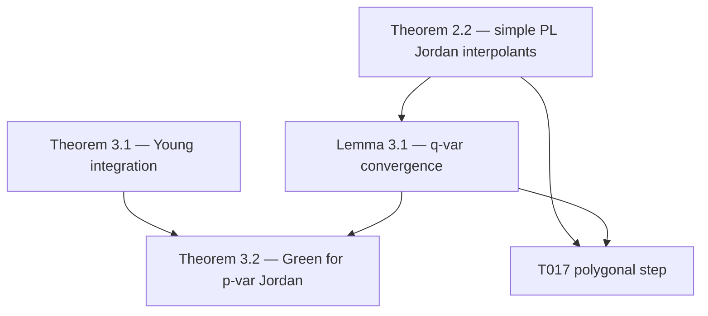

# Boedihardjo–Geng Dependency Graph (BG-INTERPOLATION-v2)

**Source:** arXiv:1309.1576v2  
**SHA-256:** `fa8be7343fa6ae97dff78a62f82a34e1680634c4684469a377d011e1658e73df`  
**Retrieval:** 2026-06-18

---

## Imported theorems (used in T017)

---

## Theorem 2.2 (§2, p. 5–6)

**Statement.** Let \(\gamma:[0,1]\to M\) be a Jordan curve and \(\tau_1,\ldots,\tau_k\) fixed times. For every \(\varepsilon>0\) there is a partition \(\mathcal P_\varepsilon\) with mesh \(<\varepsilon\), containing the \(\tau_i\), such that the piecewise **minimizing geodesic** interpolant \(\gamma^{\mathcal P_\varepsilon}\) is a Jordan curve.

**Specialization \(M=\mathbb R^2\):** geodesics are straight segments → **simple chord polygon** with vertices on \(\gamma\) in cyclic order.

**Type:** SOURCE_THEOREM (imported)

---

## Lemma 3.1 (§3.1)

Let \(\gamma\) have finite \(p\)-variation, \(f\) Lipschitz with constant \(C\).

1. \(\|f(\gamma)\|_{p\text{-var}} \le C\|\gamma\|_{p\text{-var}}\) (Friz–Victoir [11] Lemmas 1.12, 1.18).
2. For all \(q>p\): \(\|f(\gamma)-f(\gamma^{\mathcal P})\|_{q\text{-var}}\to 0\) as \(\|\mathcal P\|\to 0\) (Prop. 1.14, Rem. 1.19).

**T017 use:** \(f=\mathrm{id}\) gives \(\|\gamma-\gamma^{\mathcal P}\|_{q\text{-var}}\to 0\).

**Type:** SOURCE_THEOREM (imported)

---

## Theorem 3.1 (§3.1, Young)

If \(1/p+1/q>1\), Young integral \(\int \gamma\, d\tilde\gamma\) exists and

\[
\left\|\int_0^{\cdot}\gamma\, d\tilde\gamma\right\|_{q\text{-var}}
\le 2\zeta(1/p+1/q)\|\gamma\|_{p\text{-var}}\|\tilde\gamma\|_{q\text{-var}}.
\]

**T017 use:** \(p=q<2\) so \(2/q<1\) and \(1/q+1/q>1\).

**Type:** SOURCE_THEOREM (Young / Friz–Victoir)

---

## Theorem 3.2 (§3.1, Green)

For \(f,g\in C^1(\mathbb R^2)\), positively oriented Jordan \(\gamma\) with finite \(p\)-variation, \(1\le p<2\):

\[
\int_0^1\bigl(f(\gamma)\,dy-g(\gamma)\,dx\bigr)
=\iint_{\mathrm{Int}(\gamma)}\Bigl(\frac{\partial f}{\partial x}+\frac{\partial g}{\partial y}\Bigr)\,dx\,dy
\]

(Young integrals on the left).

**Proof pattern:** PL Jordan approximants + Lemma 3.1 + Theorem 3.1.

**Type:** SOURCE_THEOREM

---

## New lemmas (this repository)

| ID | Statement | Status |
|----|-----------|--------|
| **T018** | \(C^1\) corner-rounding with \(\|S-P\|_{1\text{-var}}<\varepsilon\) | PROVED_LOCALLY — `docs/controlled_c1_polygon_smoothing.md` |
| **Interpolation** | \(\|h\|_{q\text{-var}}\le \mathrm{osc}(h)^{1-p/q}\|h\|_{p\text{-var}}^{p/q}\) | PROVED_LOCALLY — `docs/q_variation_interpolation_proof.md` |
| **Young primitive** | Uniform \(f_n\to f\) for \(C^1\) approximants | PROVED_LOCALLY — `docs/young_primitive_convergence_proof.md` |

---

## Arrow classification

| Arrow | Type |
|-------|------|
| Jordan \(c\), finite \(p\)-var → PL \(P_n\) (Thm 2.2) | SOURCE |
| \(\|P_n-c\|_{q\text{-var}}\to 0\) (Lemma 3.1, \(f=\mathrm{id}\)) | SOURCE |
| PL \(P_n\) → \(C^1\) \(S_n\) (T018) | **NEW (proved locally)** |
| \(\|S_n-c\|_{q\text{-var}}\to 0\) | LOCAL (triangle + T018) |
| \(f_n\to f\) uniformly | LOCAL (Young + BG Thm 3.1 template) |
| AI-PEG-v3 Thm 1.1 → all \(\theta\) rectangles | SOURCE |
