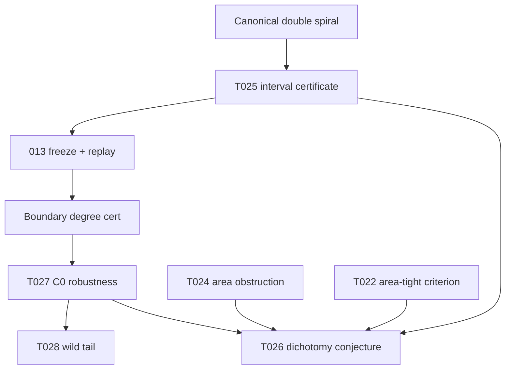

# T025 / T027 Dependency Map

## Layer summary

| Layer | Theorem | Status |
|-------|---------|--------|
| Existence | T025 | PROVED_LOCALLY |
| Replay | Independent verifier | REPLAYED |
| Degree | \(\deg(F,B,0)=-1\) | Certified |
| Robustness | T027 | PROVED_LOCALLY |
| Corollary | T028 | Corollary of T027 |
| Bridge | T026 | Conjectural |

PDF export: compile this file or use repository HTML renderer.
